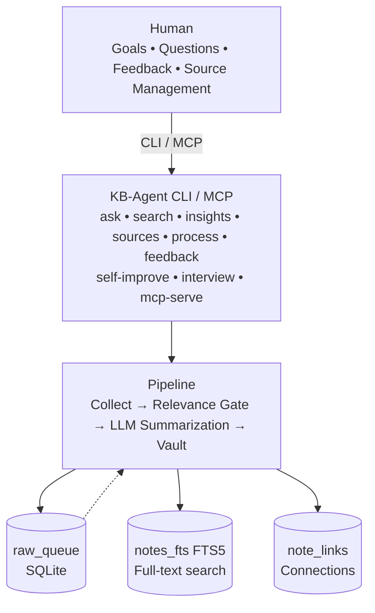

# Second Brain (personal-kb-agent)

> Collect, structure, and use knowledge from Telegram and YouTube — together with your personal AI agent.

[](https://pypi.org/project/personal-kb-agent/)
[](LICENSE)
[](https://python.org)
[](https://obsidian.md)
[](https://modelcontextprotocol.io)

---

## 🎯 What is this and why do you need it?

### The Problem kb-agent Solves

Every day you receive a stream of useful information from Telegram channels, YouTube, and your own files. Some materials get lost, some are forgotten, and connections between different sources are rarely preserved. To find a specific insight, you have to manually re-read dozens of posts.

**kb-agent** solves this: it automatically collects materials from your chosen sources, summarizes them via LLM, and saves structured notes to your Obsidian vault. Notes get tags, topics, and a link to the source; connections between notes are stored in the `note_links` table. All notes are indexed and searchable — both for you and any AI agent (Cursor, Claude Code, Hermes, OpenCode, etc.).

### JTBD (Jobs To Be Done)

| Before | With kb-agent |
|--------|---------------|
| Manually re-read channels and videos to not miss anything useful | Automatic collection of new posts and videos (via cron or manually) |
| Write important thoughts to different files, losing connections | Structured notes with tags, topics, and source links |
| Spend a long time searching where you read about a topic | Full-text search across the entire knowledge base in seconds (FTS5) |
| Forget which insights you've already discovered | Automatic insights — recurring topics, contradictions, hidden dependencies |
| Don't know where to start building a knowledge base | Introductory interview — agent helps define goals, topics, and sources |

---

## 💡 What You Get

### For Humans (Obsidian / KB Users)

| Benefit | How It Works |
|---------|--------------|
| **Nothing gets lost** | Post or video → queue → relevance filter → summarization → note in vault (irrelevant or unprocessable materials are skipped) |
| **See connections between sources** | Notes get tags, topics, and a link to the original material; connections between notes stored in `note_links` table |
| **Find what you need fast** | Full-text search (FTS5) across all notes + `kb-agent ask` command |
| **Get insights effortlessly** | Agent finds recurring topics and connections between notes (by common tags, top-3) |
| **Control your information flow** | Add/remove sources with a single command, no code changes |
| **Quality control** | Rate each note (1–5), agent adapts to your preferences |

### For AI Agents (Cursor, Claude Code, Hermes, OpenCode, Kimi Claw, etc.)

| Benefit | How It Works |
|---------|--------------|
| **Read your knowledge base** | MCP server `kb-agent mcp-serve` provides tools `kb_search`, `kb_get_note`, `kb_get_insights` |
| **Search your notes** | FTS5 search via `kb_search` |
| **Get insights** | `kb_get_insights` returns connections between notes |
| **Configure without code** | Write-tools (`kb_add_source`, `kb_remove_source`, `kb_enable_source`, `kb_update_profile`, `kb_revert_prompt`) create a pending request that applies only after explicit human confirmation via `kb-agent confirm <id>` |

---

## 🚀 Quick Start

### 1. Installation

```bash
# Clone the repository
git clone https://github.com/DenisZakharov2/personal-kb-agent.git
cd personal-kb-agent

# Install dependencies (including yt-dlp for YouTube)
pip install -e .

# Verify installation
kb-agent --version
```

### 2. Configuration (.env)

```bash
cp .env.example .env
# Edit .env — specify vault path, channels, LLM key
```

| Variable | What to specify | Example |
|----------|----------------|---------|
| `KB_VAULT_PATH` | Path to your Obsidian vault | `/home/user/Documents/KB` |
| `KB_TELEGRAM_CHANNELS` | Telegram channels (comma-separated) | `ragnarokzone,paragonzone,rubiconzone` |
| `KB_YOUTUBE_CHANNELS` | YouTube channels (full URLs) | `https://youtube.com/@amorev,https://youtube.com/@rubiconzone` |
| `KB_LLM_PROVIDER` | LLM provider | `openai`, `kimi`, `ollama`, `openrouter` |
| `KB_OPENAI_API_KEY` | Your API key | `sk-...` |
| `KB_OPENAI_BASE_URL` | Provider API URL | `https://api.openai.com/v1` |

### 3. First Interview (Required Before Start)

```bash
kb-agent interview init
```

The agent will ask several questions about your goals, topics, sources, and collection frequency — and create your `user_profile.yaml`.

### 4. Run the Pipeline

```bash
# Collect materials from all sources and summarize to vault
kb-agent process run

# Or get a run digest
kb-agent process digest
```

#### `kb-agent process run` Exit Codes

| Code | Meaning | When Returned |
|------|---------|---------------|
| `0` | Success | All sources collected without errors, queue processed without failures |
| `1` | Collection/processing error | At least one source collection error or queue processing failure (partial success counts as error) |
| `2` | Critical config error | Failed to load configuration (no profile, invalid paths, etc.) |

On any failure, CLI prints an **Source Collection Errors:** block with `source_id` and error text for each failed source, and a separate **Queue Processing Errors** block if `processing_failed > 0`. JSON output (`--json`) contains `health` (per-source status) and `summary` (totals).

### 5. Working with Your Knowledge Base

```bash
# Ask a question and get an answer with note references
kb-agent ask "What have I accumulated about AI agents?"

# Search notes (list)
kb-agent search "n8n automation"

# Insights — connections between notes (note_links table)
kb-agent insights

# Check for duplicates
kb-agent update check
```

### 6. Source Management

```bash
# List all sources
kb-agent sources list

# Add Telegram channel
kb-agent sources add telegram https://t.me/s/novyikanal

# Add YouTube channel
kb-agent sources add youtube https://youtube.com/@novyykanal

# Enable/disable source
kb-agent sources enable tg_ragnarokzone
kb-agent sources disable yt_staryykanal

# Remove source
kb-agent sources remove tg_staryykanal
```

> ⚠️ `kb-agent sources ...` commands write to the canonical source store (SQLite). Changes from MCP tools (agent) create a pending request — must be confirmed with `kb-agent confirm <id>`.

### 7. MCP Server for AI Agents

```bash
# Run server (once, in terminal or as a service)
kb-agent mcp-serve
```

Add to your AI agent config (e.g., `.cursor/mcp.json`):

```json
{
  "mcpServers": {
    "kb-agent": {
      "command": "kb-agent",
      "args": ["mcp-serve"]
    }
  }
}
```

Now your agent can:
- Search your notes: `kb_search("AI agents")`
- Read note content: `kb_get_note("note_id")`
- Get insights: `kb_get_insights()`
- Propose source/profile changes: `kb_add_source(...)` → confirm via `kb-agent confirm <change_id>`

---

## 🏗️ Architecture



**Stack:** Python 3.10+, SQLite + FTS5, Pydantic v2, Typer, Rich, httpx, MCP, PyYAML.

---

## 📋 Features by Stage

| Stage | Done | Status |
|-------|------|--------|
| **Stage 1** | Foundation, interview, core import, SQLite schema | ✅ |
| **Stage 2** | Reliable pipeline (collect + summarization + vault) | ✅ |
| **Stage 3** | Search (FTS5), LLM answers, duplicate detection, insights | ✅ |
| **Stage 4** | MCP server (read + write via pending), `--json` CLI, source management | ✅ |
| **Stage 5** | Feedback, prompt versions & rollback, monthly interview, self-improvement | ✅ |

---

## 🔄 How the Pipeline Works Under the Hood

1. **Collection** — new posts from Telegram and videos from YouTube land in `raw_queue`
2. **Relevance Gate** — material checked against your goals and topics from profile
3. **Summarization** — LLM restructures raw text into structured note (essence, ideas, tools, conclusions, tags)
4. **Write** — note saved to thematic vault folder with YAML frontmatter
5. **Indexing** — note added to FTS5 index for search
6. **Catalog** — `Catalog.md` rebuilt automatically
7. **Digest** — `Digest.md` in vault with run statistics

---

## 🔐 Security & Privacy

### Data Sent to External LLM

Notes, state database, and profile are stored locally on your machine.
However, **raw texts, found snippets, and metadata are sent to the configured
OpenAI-compatible endpoint** (OpenAI, Kimi, OpenRouter, Ollama, etc.)
for summarization and search answers:

| What is sent | To whom | When |
|--------------|---------|------|
| Raw post/video text (`raw_text`) | Configured LLM provider (`KB_OPENAI_BASE_URL`) | During pipeline summarization (`kb-agent process run`) |
| Note snippets + metadata (ID, title, tags, source URL) | Configured LLM provider | During search answers (`kb-agent ask`, `kb_search` via MCP) |
| Source metadata (source_id, channel, canonical_url) | Configured LLM provider | During summarization and search |
| API key (`KB_OPENAI_API_KEY`) | External provider (only if not Ollama/local) | Every LLM request |

If full locality matters, use a local provider (Ollama) without
API key and enable local processing mode (see below).

### Local Processing Mode

Variable `KB_LOCAL_PROCESSING_MODE=true` enables mode where data
is not sent to external LLM provider. Works only with local Ollama/
local model. External providers (OpenAI, Kimi, OpenRouter) are blocked.

```bash
export KB_LOCAL_PROCESSING_MODE=true
kb-agent process run
```

### Redaction — Excluding Sensitive Data

Variables `KB_REDACT_FIELDS` and `KB_REDACT_SOURCES` allow excluding
sensitive fields and sources from being sent to external LLM:

```bash
# Exclude email, phone, source URLs from LLM
export KB_REDACT_FIELDS="email,phone,canonical_url"

# Exclude entire content of specific sources
export KB_REDACT_SOURCES="tg_private_chan,yt_internal_channel"
```

### Sensitivity Labels in MCP

Notes and sources can be marked as private (`is_private = 1`).
Private notes **are not returned** to external agent via `kb_get_note` and
are filtered from `kb_search` results for external MCP client. Sensitivity
is indicated by `is_private` and `sensitivity` (public/internal/private/secret)
fields in structured MCP responses.

### Untrusted Content Chain & Agent Actions

- **No confirm tool in MCP.** Model cannot confirm a change
  on its own. Human confirmation — only via separate CLI channel:
  `kb-agent confirm <id>` (or `kb-agent confirm <id> --revision N`).
- **Write MCP tools** (`kb_add_source`, `kb_remove_source`,
  `kb_enable_source`, `kb_update_profile`, `kb_revert_prompt`) create
  a pending proposal but don't apply it. Application requires human
  confirmation via CLI.
- **Each pending proposal contains:** diff, payload_hash, base_revision,
  author (created_by), expiration (TTL/expires_at), one-time
  identifier (change_id).
- **On confirmation, atomically verified:** status='pending', payload_hash
  (params not tampered), current object revision.
- **Provenance metadata** for each fragment (URL, source, note_id,
  `untrusted_content` label) included in MCP responses (`kb_search`,
  `kb_get_note`).
- **Source & URL allowlist:** when adding source via MCP, host
  validated against allowlist of trusted domains (t.me, youtube.com,
  youtu.be, etc.). yt-dlp restricted to known YouTube domains.
- **Prompt injection protection:** model has no direct write tools.
  Malicious text in a note cannot cause source deletion or profile change —
  only creates a pending proposal requiring separate human confirmation.

### Dangerous Latent Config Write API

`apply_config_proposal` restricted to strict allowlist of config files,
performs atomic write (temp file + os.replace) and validates diff before
write. Attempts to write outside allowlist are rejected.

---

## 📊 Feedback & Self-Improvement

```bash
# Rate a note (1–5)
kb-agent feedback rate <note_id> 5 --comment "Great summarization"

# Leave arbitrary message
kb-agent feedback tell "Need more code examples"

# View quality metrics
kb-agent feedback metrics

# View prompt improvement proposals
kb-agent self-improve
```

## Self-Improvement (self-improve)

All subcommands support `--json` (`-j`) flag for machine output.

```bash
# Show feedback metrics and proposal list
kb-agent self-improve

# List proposals (default status: proposed)
kb-agent self-improve list
kb-agent self-improve list --status proposed
kb-agent self-improve list --status rejected --json

# Propose prompt change
kb-agent self-improve propose-prompt agent_prompt "need clarity" "new prompt text"
# or from file:
kb-agent self-improve propose-prompt agent_prompt "reason" --content-file prompts/new_agent_prompt.md

# Apply prompt proposal (requires test suite pass and confirmation)
kb-agent self-improve apply-prompt <proposal_id> "final prompt text"
kb-agent self-improve apply-prompt <proposal_id> --content-file prompts/final.md --confirmed-by user

# Reject proposal
kb-agent self-improve reject <proposal_id>

# Propose config change
kb-agent self-improve propose-config data/sources.yaml "old" "new" "reason"

# Apply config proposal
kb-agent self-improve apply-config <proposal_id> "final value"

# Rollback prompt to version
kb-agent self-improve rollback agent_prompt 1
```

Proposals stored in SQLite (`prompt_proposals`) and follow path:
`proposed → confirmed → applied/rejected/failed`.

Applying prompt and config requires test suite validation
(`tests/eval_set.json`) and explicit user confirmation — changes don't
apply automatically. Rollback also requires confirmation.

Agent collects your ratings (`kb-agent feedback rate/tell`) and computes
average score. Automatic improvement proposals generated from accumulated
feedback.

---

## 🤝 Contributing

Project develops openly. You can:

- Report bugs and suggest features via GitHub Issues
- Submit Pull Requests with improvements
- Add new sources (inherit `BaseSource` from `kb_agent/sources/base.py`)

All code changes — under MIT license.

---

## 📄 License

MIT — see [`LICENSE`](LICENSE).

---

## 🔗 Related Projects

- [Obsidian](https://obsidian.md) — note storage (vault)
- [Model Context Protocol (MCP)](https://modelcontextprotocol.io) — standard for AI agents
- [yt-dlp](https://github.com/yt-dlp/yt-dlp) — YouTube metadata and subtitles collection

---

## ⭐ If this project helped you — give it a star and share with colleagues!

*Built with ❤️ for mindful knowledge management.*