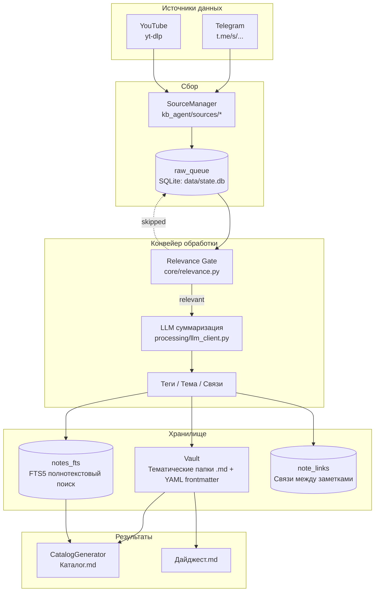
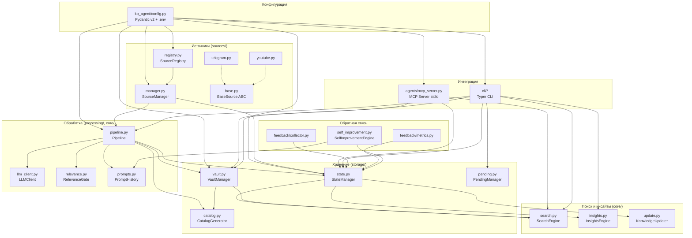
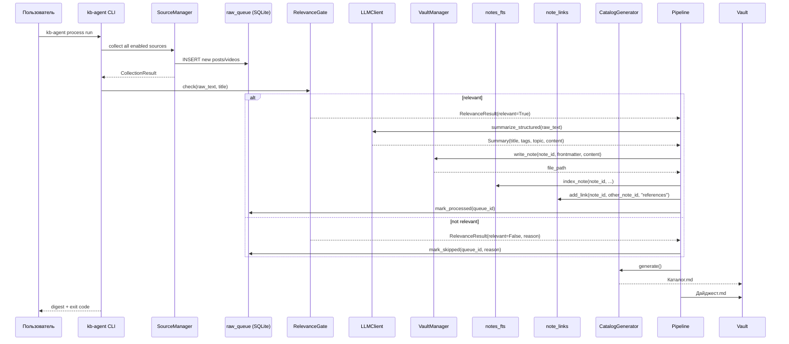

# Архитектура kb-agent

> Актуальное описание. Сборщики первого поколения (`_queue.jsonl`, ручной анализ через
> Hermes Agent) вынесены в `scripts/legacy/` и приложением **не используются**.

## Общая схема



## Архитектура компонентов (слои)



## Жизненный цикл данных (Pipeline)



## Схема базы данных (SQLite)

```mermaid
erDiagram
    raw_queue ||--o{ sources : "source_id"
    raw_queue {
        int id PK
        string source_id FK
        string external_id
        string canonical_url
        string title
        text raw_text
        string raw_hash UK
        datetime received_at
        string state
        int attempts
        text last_error
        datetime next_retry_at
        string skipped_reason
        datetime published_at
        datetime processing_started_at
        datetime lease_expires_at
        string note_id
    }

    notes ||--o{ raw_queue : "external_id"
    notes {
        string note_id PK
        string title
        string topic
        string tags
        string source_id
        string external_id
        string canonical_url
        string file_path
        string content_hash
        int revision
        datetime created_at
        datetime updated_at
        int is_private
        int is_archived
    }

    notes_fts {
        string note_id UK
        string title
        string tags
        string topic
        string content
    }

    note_links {
        string source_note_id FK
        string target_note_id FK
        string link_type
        PK (source_note_id, target_note_id, link_type)
    }

    feedback {
        int id PK
        string note_id FK
        int score
        string comment
        datetime created_at
    }

    prompt_history {
        int id PK
        string prompt_name
        int version
        text content
        string prompt_type
        int is_active
        datetime created_at
        string approved_by
        int reverted_from
    }

    sources {
        int id PK
        string source_id UK
        string source_type
        string channel
        int enabled
        datetime added_at
        datetime updated_at
        int is_private
    }

    pending_changes {
        int id PK
        string change_id UK
        string action
        string entity_type
        string entity_id
        text parameters
        string status
        datetime created_at
        datetime confirmed_at
        datetime applied_at
        string confirmed_by
        text result
        int revision
        datetime expires_at
        string reject_reason
        string content_hash
        string diff
        string created_by
    }
```

## Поток данных MCP (внешние агенты)

```mermaid
flowchart LR
    subgraph External["Внешний ИИ-агент (Cursor, Claude Code, Hermes)"]
        Agent[AI Agent]
    end

    subgraph MCP["MCP Server (kb-agent mcp-serve)"]
        STDIO[stdio transport]
        Tools[Tools: kb_search, kb_get_note, kb_get_insights, kb_add_source...]
    end

    subgraph Local["Локальная база знаний"]
        SQLite[(SQLite: state.db)]
        Vault[Vault .md files]
    end

    Agent <-->|JSON-RPC 2.0| STDIO
    STDIO --> Tools
    Tools -->|Read| SQLite
    Tools -->|Read| Vault
    Tools -.->|Write (pending)| SQLite
    Tools -.->|Confirm via CLI| CLI[kb-agent confirm <id>]
    CLI --> SQLite
```

## Слои и ответственность

| Слой | Модули | Ответственность |
|---|---|---|
| **Конфигурация** | `kb_agent/config.py` | `.env` + переменные окружения + пути (Pydantic v2) |
| **Источники** | `sources/registry.py`, `sources/manager.py`, `sources/telegram.py`, `sources/youtube.py` | SQLite-таблица `sources` как источник истины, YAML — только import/export, сбор в `raw_queue` |
| **Обработка** | `processing/pipeline.py`, `processing/llm_client.py`, `core/relevance.py`, `core/prompts.py` | Relevance Gate, суммаризация, теги и тема, связи между заметками, версии промптов |
| **Хранение** | `storage/state.py`, `storage/vault.py`, `storage/catalog.py`, `storage/pending.py` | состояние (SQLite), заметки (.md), каталог, pending-запросы |
| **Поиск и инсайты** | `core/search.py`, `core/insights.py`, `core/update.py` | FTS5-поиск, LLM-ответ, инсайты, поиск дублей |
| **Интеграция** | `agents/mcp_server.py`, `cli/*` | MCP-сервер (stdio), CLI (Typer) |
| **Обратная связь** | `feedback/*`, `core/self_improvement.py` | оценки, метрики, предложения по промптам |

## Хранение данных

- **Состояние** — SQLite `data/state.db`: `raw_queue`, `notes_fts` (FTS5), `note_links`, `feedback`, `prompt_history`, `processed`, `pending_changes`, `sources`.
- **Конфигурация источников** — SQLite-таблица `sources` в `data/state.db` (каноническое хранилище). `data/sources.yaml` используется только для импорта/экспорта; создаётся при первом запуске из `KB_TELEGRAM_CHANNELS` / `KB_YOUTUBE_CHANNELS`, иначе из `config/sources.example.yaml`.
- **Профиль** — `data/user_profile.yaml` (структура: всё внутри секции `user`).
- **Заметки** — Markdown с YAML frontmatter в тематических папках vault.
- **Промпты** — `config/prompts/agent_prompt.md`; при первом запуске импортируется в `prompt_history` как версия 1, поэтому работают откат и self-improve.

## LLM

Суммаризацию и ответы выполняет внешний LLM через OpenAI-совместимый API
(`LLMClient`, httpx, повторы при 429/5xx, настраиваемый таймаут). Локальная LLM не требуется.

### Поддерживаемые провайдеры

| Провайдер | Base URL | Модели |
|---|---|---|
| OpenAI | `https://api.openai.com/v1` | `gpt-4o-mini`, `gpt-4o`, `gpt-3.5-turbo` |
| Kimi (Moonshot) | `https://api.moonshot.cn/v1` | `moonshot-v1-8k/32k/128k` |
| OpenRouter | `https://openrouter.ai/api/v1` | Различные |
| Ollama (локально) | `http://localhost:11434/v1` | `llama3`, `mistral`, `codellama` |
| Custom | Любой OpenAI-совместимый | Любые |

## Безопасность

- **Режим локальной обработки** (`KB_LOCAL_PROCESSING_MODE=true`) — данные не уходят наружу, работает только с Ollama.
- **Редакция** (`KB_REDACT_FIELDS`, `KB_REDACT_SOURCES`) — исключение чувствительных полей/источников из отправки LLM.
- **Приватные заметки/источники** (`is_private=1`) — не возвращаются через MCP.
- **Pending-подтверждение** — write-операции требуют `kb-agent confirm <id>` человеком.
- **Allowlist доменов** — добавление источников только с доверенных хостов (t.me, youtube.com, youtu.be).

## Тестирование и качество

- **297 тестов** (pytest) — unit, integration, security
- **Ruff** — линтинг и форматирование
- **mypy** — статическая типизация (non-blocking для legacy кода)
- **pip-audit** — аудит зависимостей
- **GitHub Actions CI** — запуск на Python 3.10, 3.11, 3.12